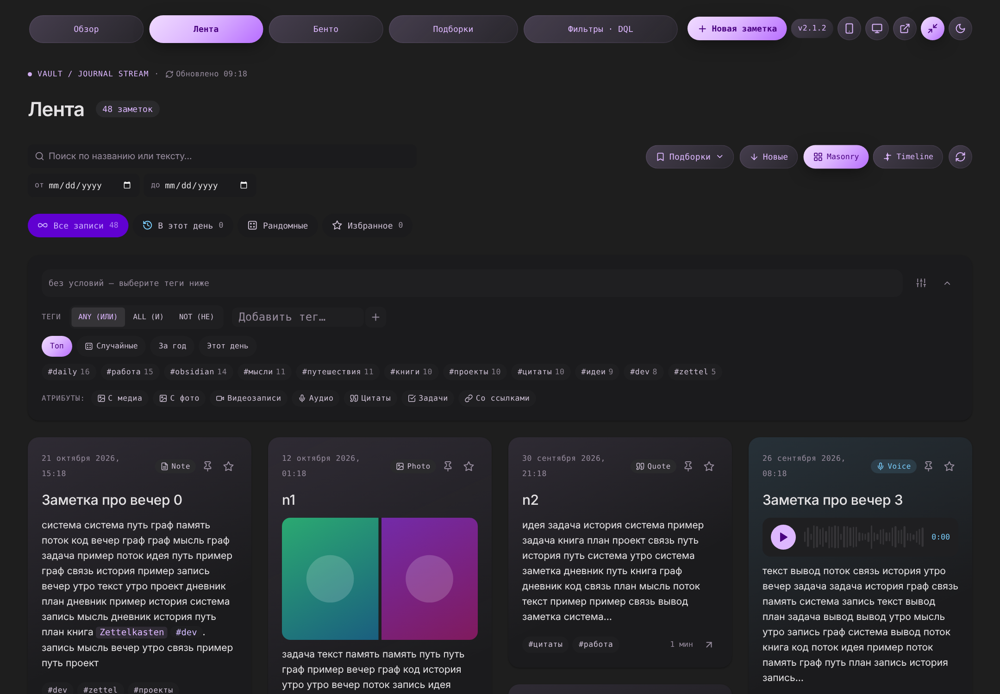
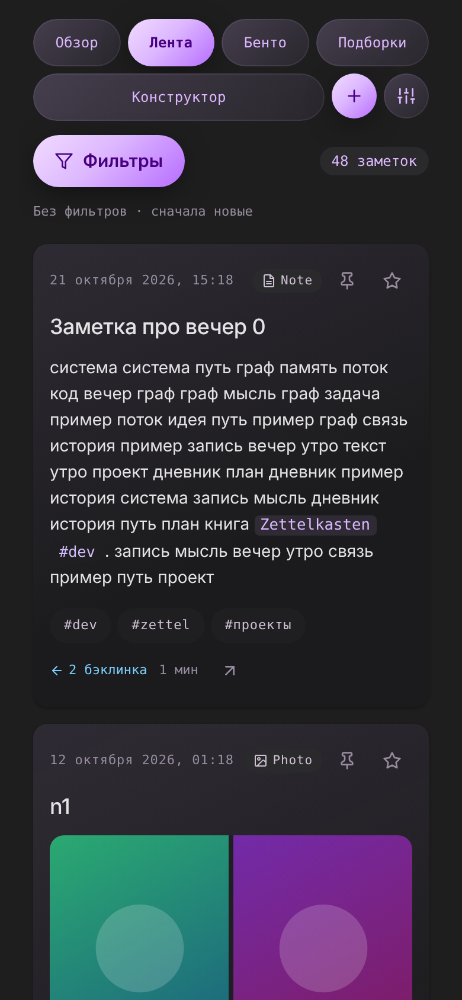

# Social Feed для Obsidian (Dataview)

**Версия 1.6.0** · [история версий](#история-версий) · исходник версии — `app/version.js`





> Скриншоты сняты в headless-Chromium на тестовых данных (`tests/browser/layout_check.py --shots`); замените их своими из Obsidian, если хотите.

Лента заметок в виде карточек «как в соцсети» по макетам *Obsidian Journal / Obsidian Stream*:
поток (masonry / timeline), Bento-сетка, смарт-подборки, конструктор фильтров с генератором DQL, обзор с пульсом месяца.
Работает на **dataviewjs** без плагинов-посредников: весь код, данные и CSS лежат в `scripts/social_feed`.

## Быстрый старт

1. Нужен плагин **Dataview** с включённым **JavaScript Queries** (Settings → Dataview → Enable JavaScript Queries).
2. Скопируйте папку `social_feed` в `<vault>/scripts/social_feed`.
3. Создайте заметку и вставьте:

````markdown
---
cssclasses: sf-page
---

```dataviewjs
await dv.view("scripts/social_feed", { view: "stream" })
```
````

`cssclasses: sf-page` растягивает заметку до 1600px (ширина по умолчанию в Obsidian слишком узкая для сетки). Страница с виджетом по умолчанию показывается **на всю ширину окна** (кнопка ⤢ в навигации переключает режим). Когда вы открываете заметку кликом по карточке, полная ширина с этой страницы снимается — заметка открывается с обычными отступами.
Готовый пример — `example-note.md`.

4. При первом запуске создаётся единый файл `data/social_feed.json`. Откройте его и в `settings.sources` поменяйте папку при необходимости (по умолчанию `notes`; `"folder": ""` — весь vault; при нескольких источниках включите `showSourceBadge`).

## Параметры вызова

```js
await dv.view("scripts/social_feed", {
  view: "stream",          // overview | stream | bento | collections | studio (по умолчанию config.defaultView)
  id: "main",              // ключ сохранения состояния; у разных заметок/блоков задавайте разные
  nav: true,               // верхняя навигация между экранами (false — «чистый» экран без вкладок)
  layout: "masonry",       // masonry | timeline
  theme: "auto",           // auto | dark | light
  fullWidth: true,         // на всю ширину окна (по умолчанию true; кнопка ⤢ в навигации)
  openInNewTab: false,     // открывать заметку по клику на карточку в новой вкладке (кнопка в навигации; Ctrl/Cmd+клик — всегда в новой)
  filter: { any: ["мысли"], period: "30d" },  // стартовый фильтр (формат — ниже)
  root: "scripts/social_feed"                 // если папку переименовали
})
```

Можно держать несколько блоков с разными `view`/`id` на одной странице, например отдельная заметка «Бенто» с `nav: false`.

## Экраны

| view | Что это | Из макетов |
|---|---|---|
| `overview` | **Пульс месяца** — 4 карточки: график накопления заметок (с динамикой к прошлому месяцу), стрик с кружками последних 7 дней, связи с плотностью графа, медиа (фото / видео / аудио) + полоса трендовых тегов; **случайные озарения** (3 / 6 / 9 / 12 карточек, выбор запоминается; 🎲 перемешивает); **годовой срез** — карта активности с подписями месяцев и дней недели, легендой и сводкой (клик по дню → лента) и кольцевая диаграмма типов заметок (клик по типу → лента) | Overview & Pulse |
| `stream` | Лента карточек: **строка поиска** (результаты сразу при вводе), меню **«Подборки»**, быстрые режимы (Все / В этот день / Рандомные 🎲 / Избранное), формула фильтра, конструктор тегов ANY/ALL/NOT, атрибуты, раскладки Masonry и Timeline | Flow Stream |
| `bento` | Те же данные в сетке-мозаике: у каждой плитки своя высота, видео и canvas шире (2 колонки), цитаты и аудио с цветным фоном. **Порядок — слева направо, затем сверху вниз** | Bento Grid |
| `collections` | Галерея смарт-подборок: правила, счётчик, мини-превью заметок **с двумя строками текста**; **вся карточка кликабельна и открывает подборку в Бенто** (кнопка «Лента» — в ленте); ✎ редактировать, 🗑 удалить (с подтверждением), 🎲 для случайных | Smart Collections |
| `studio` | Конструктор: название/иконка/режим, теги, атрибуты, период, порог бэклинков, сортировка, источники, поиск; справа — живой отклик (число и время) и готовый **DQL** с копированием. Панель действий вверху: **Сохранить**, **Сохранить как новую**, **Удалить**, Сбросить, Открыть в Бенто | Query Studio / Tag Builder |

## Состояние, прокрутка и сброс

* **Вернулись на страницу** (ушли открыть заметку и нажали «назад»): раздел, фильтры, быстрый режим, раскладка, «Показать ещё», текст поиска и **положение прокрутки** восстанавливаются. Позиция фиксируется в момент клика по карточке, а события прокрутки, которые Obsidian генерирует при смене заметки, игнорируются; восстановление повторяется, пока карточки дорисовываются. Состояние живёт в памяти окна Obsidian и **не пишется на диск** — после перезапуска Obsidian лента стартует с чистого листа.
* **Вход в раздел через навигацию** (Обзор → Лента → Бенто → Подборки → Фильтры) всегда начинается с дефолта: без фильтров, режим «Все», первая страница, **новый пустой конструктор**.
* Переходы «с переносом» не сбрасывают ничего: «Открыть подборку», клик по тегу на обзоре, клик по дню на карте активности, клик по типу в диаграмме, «Редактировать» подборку.
* На диск (в `data/social_feed.json`, раздел `ui`) сохраняются только предпочтения: раскладка ленты и «на всю ширину».

## Поиск

Поиск **по названию или тексту** есть везде, где есть фильтры: в шапке «Ленты» и «Бенто» и отдельной строкой в панели «Фильтры». Результаты обновляются сразу при вводе (задержка 0,1 с); несколько слов — условие «И»; регистр и «ё/е» не важны.

Почему раньше находились не все записи: пока тексты заметок не прочитаны, поиск видит только заголовки и теги. Теперь индексация текстов стартует **сама** вскоре после открытия ленты (`autoIndex`), одна нечитаемая заметка её не прерывает, ищется весь текст заметки (а не превью), а рядом с полем виден прогресс «индексация N/M»; по завершении результаты пересчитываются автоматически. Если в результатах меньше записей, чем ожидалось, проверьте формулу над лентой (активные условия) и кнопку «Показать ещё» (за раз показывается `pageSize` карточек). Esc или ✕ очищают поле.

**Фильтр дат.** Рядом со строкой поиска два поля даты — «от» и «до». Текст, «от» и «до» — **три независимых параметра**: можно задать любой из них, любые два или все три; при изменении любого фильтр применяется сразу, границы включительны. Условия видны в формуле над лентой (каждое снимается крестиком) и попадают в DQL и в сохраняемые подборки. Дата заметки — та же, что в карточке (поле даты → имя файла → дата создания). Для больших vault индексация читает все заметки один раз за сеанс (⟳ сбрасывает индекс).

## Подборки: меню, сохранение, удаление

* **Меню «Подборки ▾»** в панели ленты/бенто: список сохранённых подборок со счётчиками — клик применяет подборку, не покидая экран. Внизу — поле «Название» и кнопка **Сохранить**: текущий фильтр и режим сохраняются как подборка.
* **Удаление**: 🗑 в меню, на карточке подборки или кнопка «Удалить» в конструкторе. Первый клик превращает кнопку в «Удалить?», второй — подтверждает (через 2,5 с подтверждение снимается).
* В **конструкторе** «Сохранить подборку» требует название; для открытой существующей подборки доступны «Сохранить изменения» и «Сохранить как новую».
* Подборки лежат в `data/social_feed.json` (`presets`) и правятся руками.

## Раскладки

| | Что делает |
|---|---|
| **Masonry** (экран «Лента») | карточки разной высоты; каждая занимает самое короткое место (при равенстве — левее), поэтому порядок читается слева направо и сверху вниз, а высота «строки» ни к чему не привязана. Число колонок — `columns.min…max` по ширине блока |
| **Timeline** (экран «Лента») | лента по дням с вертикальной линией; внутри дня **по две карточки в ряд одинаковой высоты**, если ширины мало — по одной. Режим Flow удалён как дубликат Timeline (старое значение `flow` читается как `timeline`) |
| **Bento** (экран «Бенто», а также «Подборки») | тот же движок плиток, но видео/canvas (и первая подборка-«герой») занимают две колонки. Число колонок — те же `columns` |

Размер текста цитат — `--sf-quote-size` (по умолчанию `calc(17px / 1.5)`), меняется в `css/90-custom.css`.

## Типы карточек

Тип определяется автоматически (приоритет сверху вниз), либо явно через frontmatter `type: audio|video|image|quote|tasks|link|canvas|text`.

| Тип | Условие | Тело карточки |
|---|---|---|
| video | в заметке встроено видео (`![[x.mp4]]`) | плеер + текст |
| audio | встроено аудио (`![[x.m4a]]`) | плеер с «волной» и прогрессом + текст |
| canvas | встроен `.canvas` | плитка «Открыть в Canvas» + текст |
| image | встроены изображения | сетка до 4 фото в рамке 16:10, centerCrop (обрезка по центру), «+N»; при наведении не меняется |
| quote | тег из `quoteTags` (`#цитата`…) или цитаты занимают > 40% текста | крупная цитата (`> [!quote] Автор`) + остальной текст |
| tasks | ≥ 2 задач `- [ ]` | прогресс-бар + первые 6 задач |
| link | внешний URL и < 45 слов | превью ссылки (домен/адрес) |
| text | всё остальное | markdown-превью (обрезается «…»; открыть заметку целиком — клик по карточке) |

Вики-ссылки `[[…]]` внутри текста стилизуются как в `DESIGN.md` (моно-шрифт, фиолетовая плашка). В подборках и живом отклике заметки показываются как **rich-link** с иконкой типа, датой и числом связей.

**Дата и время** в карточке показываются в формате самих заметок: «1 октября 2024, 16:12». Дата берётся из первого найденного поля `dateFields` (frontmatter), иначе из имени файла (`YYYY-MM-DD`), иначе из даты создания файла. Распознаются форматы `2024-10-01 16:12`, `2024-10-01T16:12`, `01.10.2024 16:12` и русские `1 октября 2024, 16:12` / `1 окт 2024 г. в 16:12`. Если в поле даты нет времени, оно берётся из отдельного поля `time` / `время`; можно также включить `timeFallback: "ctime"` (или `"mtime"`) — тогда время подставляется из даты создания (изменения) файла. Без времени показывается только дата.

## Клики по карточке

* **Клик по карточке** (по свободному месту) открывает заметку; по тегу, ссылке, кнопке, плееру — срабатывает сам элемент. Вкладку выбирает настройка «открывать в новой вкладке» (кнопка в навигации, `openInNewTab`); Ctrl/Cmd+клик или средняя кнопка — всегда новая вкладка.
* **Клик по тегу** (чип в футере карточки или `#тег` в тексте) применяет тег **на этой странице** как фильтр — глобальный поиск Obsidian не открывается. В «Обзоре» и «Подборках» клик по тегу переносит в ленту с этим фильтром.
* `[[Вики-ссылки]]` внутри текста открываются по тем же правилам, что и заголовок.

## Мобильная версия

Интерфейс подстраивается под ширину самого блока: **< 560px** — один столбец и мобильный интерфейс (`is-mobile`), **< 900px** — компактный (`is-compact`). На телефоне экран максимально освобождён — в «Ленте» и «Бенто» остаются только три вещи:

1. **Разделы** — кнопки идут потоком и переносятся на новую строку, если не хватает места (никакой прокрутки); рядом круглая кнопка **⚙ «Настройки»**.
2. **Кнопка «Фильтры (N)»** — открывает **модальное окно** со всеми фильтрами: условия «Применено», поиск и даты (от/до), режим (Все / В этот день / Рандомные / Избранное), подборки, теги (Топ / Случайные / За год / Этот день), атрибуты, условия (период, связи, сортировка, источники), порядок и вид (Новые/Старые, Masonry/Timeline). Фильтры применяются сразу; нижняя панель: «Сбросить», «Перечитать хранилище» и «Показать N заметок» (закрывает окно). Esc, ✕ или тап по затемнению тоже закрывают его.
3. **Краткая сводка** применённых условий (подборка, режим, теги, атрибуты, поиск, даты, период…) и число заметок; тап по сводке открывает то же окно. Нет условий — «Без фильтров · сначала новые».

**«Настройки»** (⚙) — окно с переключателями, которые на телефоне не занимают место в шапке: вид (авто / мобильный / десктопный), тема (как в Obsidian / светлая / тёмная), открывать заметки в новой вкладке, страница на всю ширину, версия со ссылкой на историю.

Остальное на телефоне: карта активности на обзоре — за последние 26 недель и помещается в ширину; блок кода DQL переносится по строкам; длинные теги и названия сжимаются с многоточием; карточек за раз — `pageSizeMobile`; крупные цели касания; поля 16px (iOS не увеличивает страницу). **Горизонтальной прокрутки нет** — ни у страницы, ни внутри виджета (проверяется в реальном браузере, см. «Тесты»). «Конструктор» (`studio`) на телефоне сохраняет обычную панель фильтров. Оформление — `css/85-responsive.css`, `css/36-modal.css`.

## Теги, сортировка и атрибуты

* **Наборы тегов** (вкладки над чипами в панели фильтров): **Топ** — самые частые; **Случайные** — случайная выборка, повторный клик перемешивает; **За год** — самые частые за последние 12 месяцев; **Этот день** — теги заметок, написанных в этот день в прошлые годы. Поле ввода с автодополнением ищет по всем тегам вне зависимости от набора.
* **Сортировка по времени**: кнопка «Новые ↓» / «Старые ↑» в шапке ленты и бенто; по умолчанию — сначала новые. Другие варианты сортировки (связи, длина, алфавит) — в «Условиях» панели и в конструкторе.
* **Атрибуты** (С медиа, Фото, Видео, Аудио, Цитаты, Задачи, Со ссылками) — единственный способ фильтровать по виду контента; прежний ряд «Тип» убран как дублирующий.

## Мобильный и десктопный вид вручную

В правой части навигации две кнопки: 📱 «мобильный вид» и 🖥 «десктопный вид». **Мобильный** показывает интерфейс как на телефоне даже на компьютере (узкая рамка по центру, один столбец, фильтры свёрнуты) — удобно проверять и настраивать. **Десктопный** показывает колонки (`columns.min…max`) и широкую шапку даже на узком экране телефона (блок не уже 760px, страницу можно прокрутить вбок). Повторный клик по включённой кнопке возвращает автоопределение по ширине. Выбор запоминается в `data/social_feed.json` (`ui.viewMode`: `auto` \| `mobile` \| `desktop`), задать вручную можно и параметром `dv.view(..., { viewMode: "mobile" })`.

## Тема и фон

Кнопка темы в навигации — иконка (☾ / ☀), переключает тёмную/светлую тему виджета. Когда вы переключаете тему самого Obsidian, выбор виджета сбрасывается на «auto» и снова следует глобальной теме. У виджета нет собственного цвета фона — виден фон заметки; чтобы вернуть, добавьте в `css/90-custom.css`: `.sf-root { --sf-root-bg: var(--sf-canvas); }`.

## Тема и оформление

Оформление построено по `dashboard.html`: тональные слои без рамок, карточки со скруглением 1rem, при наведении фон карточки становится светлее, pill-фильтры, моно-чипы правил, акцентная кнопка. Переключатель темы «Тёмная / Светлая» — в правой части навигации (запоминается); `auto` следует теме Obsidian.

## Кнопка «Наверх»

После прокрутки вниз на 400px в правом нижнем углу прокручиваемой области заметки появляется круглая кнопка ↑ (акцентный градиент); клик плавно возвращает к началу страницы. Кнопка технически живёт в `<body>` (`position: fixed`) и сама подстраивает положение под область заметки.

## Формат фильтра

```json
{ "any": ["мысли", "zettel"], "all": [], "not": ["архив"],
  "attrs": ["media", "task"], "types": ["audio"], "sources": ["lj"],
  "period": "30d", "dateFrom": "2026-01-01", "dateTo": "2026-05-31", "day": "2026-05-14", "minBacklinks": 3, "text": "", "sort": "date-desc" }
```

* `any` — хотя бы один тег (OR); `all` — все теги (AND); `not` — ни одного (NOT). Группы соединяются через AND. Тег `a` совпадает и с `a/b`.
* `attrs`: `media photo video audio quote task link`. `period`: `all 7d 14d 30d 3m 1y`.
* `sort`: `date-desc date-asc mtime-desc backlinks-desc length-desc alpha-asc`.
* Быстрый режим (`quick`): `all | today | random | favorites`, применяется после фильтра; `random` берёт `randomCount` записей, «Перемешать» меняет только seed.

## Данные — один рабочий файл `data/social_feed.json`

**Что это за файл.** `scripts/social_feed/data/social_feed.json` — единственный рабочий файл виджета: в нём хранятся ваши настройки, смарт-подборки, избранное/закрепы и предпочтения интерфейса (раскладка, ширина, тема, вкладка). Он создаётся сам при первом запуске.
**Как сбросить всё в дефолт.** Закройте заметку с виджетом, **удалите этот файл** и откройте заметку снова — он пересоздастся со стандартными настройками и подборками. Ничего другого удалять не нужно (код и CSS лежат отдельно; ваши заметки виджет не меняет).

Всё, что настраивается или накапливается, хранится в **одном файле**. Хотите всё обновить или сбросить — **удалите его**: при следующем открытии он создастся заново с настройками и подборками по умолчанию. (Если рядом лежат файлы старой версии `config.json`, `presets.json`, `flags.json` — они один раз подхватятся при создании нового файла.)

```json
{
  "version": 1,
  "settings": { "...": "настройки (см. ниже)" },
  "ui":       { "layout": "masonry", "fullWidth": true, "openInNewTab": false, "theme": "dark" },
  "presets":  [ { "id": "...", "name": "...", "icon": "bolt", "description": "...", "quick": "all", "filter": { } } ],
  "flags":    { "notes/путь/к/заметке.md": { "favorite": true, "pinned": true } }
}
```

Файлы **заметок никогда не изменяются**: избранное и закрепы живут в `flags`. Заметка также считается избранной, если у неё `favorite: true` или тег из `favoriteTags`.
Файл можно править руками (Obsidian не нужно перезапускать — обновите заметку); после ручных правок убедитесь, что JSON валиден.

### Настройки (`settings`)

| Ключ | По умолчанию | Описание |
|---|---|---|
| `sources` | `notes` | `[{id, label, folder, enabled}]`; пустой `folder` = весь vault |
| `excludeFolders` / `excludeTags` | `scripts`, `.obsidian`, `templates` / — | что не показывать |
| `dateFields` | `date, Date, created, дата, Дата, datetime, …` | поля frontmatter с датой (по порядку); формат — ISO или русский («1 октября 2024, 16:12») |
| `timeFallback` | `none` | откуда брать время, если в дате заметки его нет: `none` \| `ctime` \| `mtime` (ещё читается поле `time`/`время`) |
| `openInNewTab` | `false` | открывать заметку по клику на карточку в новой вкладке |
| `quoteTags`, `favoriteTags`, `favoriteField` | `цитата…`, `избранное…`, `favorite` | как распознавать цитаты и избранное |
| **`columns`** | `{ "min": 2, "max": 4 }` | **число колонок карточек на десктопе** (masonry и бенто) |
| **`minCardWidth`** | `320` | минимальная ширина карточки, px: по ней считается, сколько колонок помещается; результат ограничивается `min`/`max`. Окно уже 560px (телефон) — всегда 1 колонка |
| `fullWidth` | `true` | страница на всю ширину окна; то же — параметр `fullWidth`, кнопка ⤢ в навигации (запоминается) или `cssclasses: sf-page-full`. При клике на карточку полная ширина с этой страницы снимается |
| `theme` / `nav` / `defaultView` / `layout` | `auto` / `true` / `stream` / `masonry` | оформление и стартовые экраны |
| `pageSize`, `pageSizeMobile`, `excerptChars`, `randomCount`, `insightsCount`, `insightsOptions`, `topTags` | 24, 12, 420, 12, 3, [3, 6, 9, 12], 24 | размеры выборок (на телефоне карточек за раз — `pageSizeMobile`) |
| `singleColumnBelow` | `560` | ширина блока (px), ниже которой включается один столбец и мобильный интерфейс |
| `concurrency` | 8 | сколько заметок читать параллельно |
| `debug` | `false` | подробный лог восстановления прокрутки в консоль (Ctrl+Shift+I) — пригодится, если прокрутка снова не восстановится |
| `autoIndex` | `true` | после открытия ленты (через 0,6 с) в фоне индексировать тексты заметок: поиск находит и по тексту, а не только по заголовкам и тегам |
| `deepScan` | `false` | прочитать тела **всех** заметок в фоне при открытии (точные типы/цитаты и поиск по тексту сразу; медленнее на больших vault) |
| `showSourceBadge` | `false` | бейдж источника на карточке (имеет смысл при нескольких источниках) |
| `dql.dateExpr` | `file.cday` | какое выражение даты подставлять в DQL (например `date`) |

> Без `deepScan` тип карточки и атрибуты «цитаты/ссылки» определяются по тегам/вложениям (из метаданных Dataview), а точно — после чтения тела при отрисовке карточки. Фильтр по типу и «цитатам» поэтому может не видеть ещё не показанные заметки; включите `deepScan` (или просто воспользуйтесь поиском — он тоже индексирует тексты).

## CSS — `css/`

Файлы подключаются одним `<style>` по алфавиту имён:

| Файл | Содержимое |
|---|---|
| `00-tokens.css` | **все** цвета, радиусы, шрифты (светлая тема + тёмная; токены из `DESIGN.md`); `--sf-quote-size` — размер текста цитат, `--sf-surface-hover` — цвет карточки при наведении |
| `10-base.css` | корень, кнопки, чипы, поля ввода, пустые состояния |
| `15-fullwidth.css` | режим «на всю ширину» (`.is-full`, `.sf-page-full`) |
| `35-menu.css` | поиск, выпадающее меню «Подборки», кнопка с подтверждением |
| `20-shell.css` | навигация, тулбар, крошки, сегменты раскладок |
| `30-filters.css` | быстрые режимы, панель фильтров, формула, тег-билдер |
| `40-card.css` / `41-card-types.css` | карточка и тела по типам, rich-link |
| `50-feed.css` | masonry, timeline, bento |
| `60-overview.css`, `70-collections.css`, `80-studio.css` | соответствующие экраны |
| `85-responsive.css` | desktop ≥1280 · tablet 768–1279 · mobile <768 |
| `90-custom.css` | **ваши** переопределения (подключается последним) |

Тема `auto` следует теме Obsidian; `theme: "dark" | "light"` фиксирует её. Шрифты Geist / Inter / JetBrains Mono используются, если установлены в системе, иначе — шрифты Obsidian.
Классы начинаются с `sf-` и не затрагивают остальной интерфейс.

## Структура

```
scripts/social_feed/
├─ view.js                 точка входа dv.view(...): bootstrap, показ ошибок
├─ core/loader.js          CommonJS-загрузчик: читает все *.js из папки и даёт require("app/main")
├─ app/                    композиция приложения
│  ├─ main.js              данные → конфиг → CSS → сервисы → контекст → оболочка
│  ├─ shell.js             корень, тема, переключение экранов, восстановление прокрутки, toast
│  ├─ state.js             реактивный стор (восстановление из session, UI-предпочтения → файл данных)
│  ├─ version.js           версия виджета (единственный источник)
│  ├─ actions.js           ВСЕ изменения состояния (enterView — со сбросом, openPreset/jumpToTag — с переносом)
│  └─ open-note.js         открытие заметки (Ctrl/Cmd — новая вкладка)
├─ lib/                    чистые утилиты: dom, icons, date, ru, text, random, store, async, layout, misc
├─ model/                  post.js (страница → пост), analyzer.js (разбор тела), media-kinds.js
├─ types/                  реестр типов карточек: video audio canvas image quote tasks link text
├─ filters/                state, predicates, engine, sorters, periods, attrs, quick-modes,
│                          pipeline, formula, summary (сводка для телефона), dql, presets
├─ stats/                  activity (карта, стрик, легенда), period (пульс месяца), tags, types
├─ services/               db (единый файл данных), storage, session, scroll, indexer, css-loader, md, media,
│                          content, flags, presets, posts, config (значения по умолчанию)
├─ ui/
│  ├─ common/              skeleton (шиммеры), chip, icon-button, segmented, select, empty, nav, rich-link, toast,
│  │                       dropdown, confirm-button, scroll-top, version-badge, modal, settings-modal
│  ├─ card/                card, header, footer, links (клики по тегам/ссылкам в тексте), bodies/{text,quote,audio,video,image,canvas,tasks,link}
│  ├─ feed/                feed, tile-grid (общий движок плиток), masonry, bento, layouts, groups, load-more,
│  │                       toolbar, mobile-bar, sort-toggle
│  ├─ filters/             quickbar, search-bar, presets-menu, formula-bar, tag-builder,
│  │                       attr-toggles, advanced, filter-panel, filters-modal
│  ├─ overview/            pulse, charts (спарклайн, кольцо), heatmap, distribution, insights
│  ├─ collections/         preset-card
│  └─ studio/              action-bar, meta-panel, dql-panel, dql-highlight, live-preview
├─ views/                  overview, stream, bento, collections, studio, feed-view (фабрика), index
├─ css/                    см. таблицу выше
├─ data/                   social_feed.json (создаётся при первом запуске)
├─ img/                    desktop.png, mobile.png — скриншоты для README
└─ tests/                  run.js, fake-dom.js, fixtures.js, browser/ (layout_check.py, harness.html) — в Obsidian не загружаются
```

Правила слоёв: `lib`, `model`, `types`, `filters`, `stats` — чистые функции без DOM и Obsidian API (тестируются в Node); `services` — доступ к vault/Dataview/файлам; `ui` — только отрисовка и вызов `ctx.actions`; `views` — сборка экранов из `ui`.
Модуль подключается как `require("lib/dom")` (путь от корня папки) или относительно; `index.js` в папке можно импортировать по имени папки (`require("types")`). Новые `.js` файлы подхватываются автоматически — список модулей нигде не ведётся.

## Как расширять

* **Новый тип карточки**: добавьте `types/<id>.js` (`{id, label, icon, match(post, feats)}`), включите его в список в `types/index.js` (порядок = приоритет), добавьте `ui/card/bodies/<id>.js` с `render(ctx, post, feats, el)` и перечислите в `ui/card/bodies/index.js`; стили — в `css/41-card-types.css`.
* **Новый экран**: `views/<id>.js` → `{id, title, icon, render(ctx, el)}` (можно вернуть функцию-деструктор), добавьте в `views/index.js`.
* **Новое условие фильтра**: функция в `filters/predicates.js`, поле в `filters/state.js` (`defaultFilter`), при необходимости — в `formula.js` и `dql.js`.
* **Своё оформление**: `css/90-custom.css` или переменные `--sf-*` из `00-tokens.css`.

## История версий

Номер версии показан на странице (бейдж `v1.0.0` рядом с названием; при `nav: false` — внизу страницы) и ведёт сюда. После обновления кода при первом открытии показывается уведомление «обновлён: vX → vY». Версия записывается в рабочий файл `data/social_feed.json` (поле `appVersion`).

### v1.6.0 — 2026-10-19
Мобильный интерфейс в один экран.
- **Лента и Бенто на телефоне** — только разделы, кнопка «Фильтры (N)» и краткая сводка применённых условий. Все фильтры (поиск, даты, режим, подборки, теги, атрибуты, условия, порядок и вид) — в **модальном окне**; фильтры применяются сразу, «Показать N» закрывает окно.
- **Разделы потоком**: кнопки переносятся на новую строку (без прокрутки); служебные переключатели (вид, тема, вкладка, ширина, версия) вынесены в окно **«Настройки»** (⚙). Короткая подпись конструктора — «Конструктор» (не путается с кнопкой «Фильтры»).
- **Нет горизонтальной прокрутки** на телефоне и планшете: карта активности — 26 недель на телефоне, ячейки тянутся по ширине; DQL переносится по строкам; длинные теги и названия сжимаются; вкладки переносятся. Исправлена установка CSS-переменных через `style` в `h()`.
- **Проверка раскладки в реальном браузере** (`tests/browser/layout_check.py`, Playwright/Chromium): 8 ширин × все экраны × обе темы + стресс-данные + окна «Фильтры» и «Настройки».
- README: скриншоты `img/desktop.png` и `img/mobile.png` в начале.

### v1.5.0 — 2026-10-18
- **Теги — «подкладки» наборов**: Топ · Случайные (повторный клик перемешивает) · За год · Этот день (теги заметок, написанных в этот день в прошлые годы). Выбранные теги всегда остаются первыми.
- **Порядок по времени** в ленте и бенто: кнопка «Новые ↓ / Старые ↑» в шапке (по умолчанию — сначала новые).
- **Фильтры**: остались только атрибуты, ряд «Тип» убран (он дублировал атрибуты); клик по типу в диаграмме обзора и стандартные подборки теперь ставят атрибут. Подпись «FORMULA» убрана.
- **Панель фильтров** компактнее: переключатели «Условия» и «Свернуть/Развернуть» — только иконки (на телефоне — кнопка «Фильтры (N)»). Защита от горизонтальной прокрутки на планшете (`overflow-x: clip`, перенос диапазона дат, сжимаемые элементы шапки).
- «В этот день» — без даты в названии кнопки.
- **Тема**: кнопка темы — только иконка (без подсказки и подписи); при переключении темы Obsidian выбор темы в виджете сбрасывается на «auto» (глобальная тема).
- **Фон**: у самого виджета нет цвета фона — виден фон заметки Obsidian (вернуть: `.sf-root { --sf-root-bg: var(--sf-canvas); }` в `css/90-custom.css`).

### v1.4.0 — 2026-10-17
- **Фильтр дат «от» и «до»** рядом со строкой поиска (в шапке ленты/бенто и в панели конструктора). Текст, «от» и «до» — три независимых параметра: изменение любого сразу применяет фильтр; границы включительно; каждая дата снимается крестиком в формуле. Поддержан в DQL и в сохраняемых подборках (`dateFrom`, `dateTo`).
- **Кнопка «Наверх»** (исправление): теперь `position: fixed` в `<body>` с положением по прокручиваемой области заметки — раньше `sticky` не срабатывал, если у родителя есть `overflow`. Появляется после 400px прокрутки; при перерисовке блока и уходе со страницы не плодится и убирается.
- **Картинки** (исправление): centerCrop — рамка фиксированных пропорций 16:10, картинка заполняет её и обрезается по центру; при наведении ничего не меняется (убраны масштаб, фильтр и зависимость от естественного размера).

### v1.3.0 — 2026-10-17
- **Верхние кнопки** (вкладки разделов, кнопки справа, «Подборки», раскладки, главная кнопка) — скруглённые «пилюли» в цвет акцента с градиентом: неактивные — мягкий градиент, активная — полная заливка. Все кнопки на месте и на телефоне (кнопку ширины больше не прячем).
- **Мобильный / десктопный вид вручную**: кнопки 📱 и 🖥 в навигации. «Мобильный» — как на телефоне даже на компьютере (узкая рамка, один столбец, свёрнутые фильтры); «десктопный» — колонки по `columns` даже на телефоне (блок не уже 760px). Повторный клик возвращает автоопределение; выбор запоминается (`ui.viewMode`).
- **Прокрутка при возврате** (исправление): контейнер прокрутки определяется надёжно — по событиям прокрутки, подсказке из прошлого сеанса и известным контейнерам Obsidian; «ложные» обёртки с `overflow:auto` больше не дают `scrollTop = 0` при клике по карточке. Позиция удерживается 3 с после восстановления. `debug: true` в настройках пишет ход восстановления в консоль.

### v1.2.0 — 2026-10-17
- **Обзор по макету**: «Пульс месяца» — 4 карточки с графиком накопления, стриком по 7 дням, плотностью связей и разбивкой медиа + трендовые теги; годовой срез с картой активности и диаграммой типов. Плитки «Пространства» убраны.
- **Карта активности** получила подписи месяцев и дней недели, легенду с диапазонами, пояснение «что такое квадраты» и сводку (всего, активных дней, рекорд).
- **Случайные озарения**: число карточек выбирается (3 / 6 / 9 / 12, `insightsCount`, `insightsOptions`), запоминается; карточки раскладываются как в ленте.
- **Карточки**: градиентная заливка как в подборках (оттенок зависит от типа), кнопка «Читать далее» убрана — вся карточка кликабельна.
- **Навигация**: бренд-чип «Journal Stream» убран; вкладки растянуты на всю ширину шапки (на телефоне и планшете — отдельной строкой, у «Фильтры · DQL» короткая подпись), справа — версия и переключатели.
- **Шиммеры загрузки** вместо пустого места: стартовая заглушка до загрузки модулей, затем «скелет» ленты, пока строится экран и раскладываются карточки.
- **Поиск**: строка «по названию или тексту» в панели фильтров конструктора; автоиндексация текстов (`autoIndex`), поиск по всему тексту заметки, ё=е, устойчивость к нечитаемым заметкам.
- **Прокрутка при возврате** (исправление): позиция читается до перерисовки, пока идёт восстановление новые значения не сохраняются, высота виджета резервируется, восстановление «удерживается» 1.5 с; прокрутка не прыгает вверх при «Показать ещё» и смене фильтров.

### v1.1.0 — 2026-10-17
Оптимизация под телефон (один столбец).
- Адаптивность по ширине самого блока (а не окна): `is-compact` < 900px, `is-mobile` < `singleColumnBelow` (560px) — работает и в узкой боковой панели.
- Один столбец: Masonry, Bento, Подборки; Timeline без левой колонки — дата заголовком над карточками; зазоры 14px.
- Навигация в две строки (бренд и переключатели · вкладки с прокруткой), заголовок, поиск на всю ширину, ниже — «Подборки», раскладка, обновление (раскладки — иконками).
- Быстрые режимы — одна прокручиваемая строка (дата в «В этот день» скрыта); панель фильтров по умолчанию свёрнута до кнопки «Фильтры (N)» с числом активных условий (`collapsed: null` = авто).
- Крупные цели касания (38–44px), поля 16px (iOS не масштабирует страницу), меню «Подборки» и подсказки тегов — на всю ширину, действия конструктора — сеткой 2×N, обзор: метрики по две в ряд, тепловая карта открывается на свежих неделях.
- Новые настройки: `pageSizeMobile` (12 карточек за раз), `singleColumnBelow` (560).

### v1.0.0 — 2026-10-17
Первая версионированная сборка.
- Введено версионирование: единый источник версии `app/version.js`, бейдж версии на странице со ссылкой на эту историю, уведомление после обновления, версия в файле данных.
- Без изменений поведения относительно 0.5.0.

### v0.5.0
- Оформление по `dashboard.html`: тональные слои без рамок, карточки 1rem, hover «на ступень светлее», pill-фильтры, моно-чипы; переключатель темы в навигации.
- Общий движок плиток для Masonry, Bento и «Подборок»: порядок слева направо, потом сверху вниз; первая подборка — «герой» на 2 колонки.
- Клик по карточке открывает заметку; тег (чип и `#тег` в тексте) применяется на странице; опция открытия в новой вкладке.
- Страница на всю ширину по умолчанию, при открытии заметки по карточке ширина снимается.
- Дата и время как в заметках («1 октября 2024, 16:12»), русские форматы дат, `time`/`timeFallback`.
- Восстановление прокрутки при возврате на страницу (фиксация при клике, игнор сбросов Obsidian).
- Автодополнение тегов и кнопка «+» (мобильный Enter/«Готово»); кнопка «Наверх».
- Формула показывает все условия фильтра; пустое состояние объясняет, что применено.

### v0.4.0
- Единый рабочий файл данных `data/social_feed.json` (настройки, подборки, избранное, UI-предпочтения; удалить — сброс).
- Состояние сохраняется при возврате в заметку; вход в раздел всегда с дефолта; новый конструктор при каждом входе.
- Строка поиска с мгновенными результатами и фоновой индексацией текстов; меню «Подборки»; сохранение/удаление подборок (с подтверждением); панель действий конструктора.
- Колонки `columns.min/max` и `minCardWidth`; режим Flow удалён (остался Timeline: по две карточки в ряд).
- Пульс месяца: «Добавлено фото/видео»; цитаты мельче; подсветка карточки при наведении.

### v0.3.0
- Дата в карточках в формате заметок; Timeline ограничен по ширине; картинки не «прыгают» при наведении.

### v0.2.0
- Папка по умолчанию `notes`; режим «на всю ширину» (кнопка ⤢, параметр `fullWidth`, `cssclasses: sf-page-full`).

### v0.1.0
- Первая сборка: экраны Обзор / Лента / Бенто / Подборки / Студия, типы карточек, фильтры и генератор DQL, смарт-подборки, README и тесты.

> Записи 0.1–0.5 восстановлены задним числом по порядку доработок; даты у них не указаны.

## Версионирование

Схема `MAJOR.MINOR.PATCH`: **PATCH** — исправления без новых возможностей; **MINOR** — новые возможности и изменения оформления, совместимые с имеющимся файлом данных; **MAJOR** — несовместимые изменения (формат `data/social_feed.json`, параметры `dv.view`). Как выпустить версию:
1. Поднять `VERSION` и `RELEASED` в `app/version.js`.
2. Добавить в этот README раздел `### vX.Y.Z — дата` вверху «Истории версий» и обновить строку версии под заголовком.
3. Запустить `node scripts/social_feed/tests/run.js` — тест проверит, что запись для текущей версии есть в README.
Если меняется формат файла данных — увеличить `version` в `services/db.js` и добавить миграцию там же.

## Тесты

**Проверка раскладки в реальном браузере** (нужен Python-пакет `playwright` с Chromium):

```bash
python3 scripts/social_feed/tests/browser/layout_check.py          # проверка
python3 scripts/social_feed/tests/browser/layout_check.py --shots  # + скриншоты img/desktop.png и img/mobile.png
```

Скрипт открывает страницу-имитацию режима чтения Obsidian (`tests/browser/harness.html`: настоящие модули и CSS виджета, фиктивные `dv`/`app`, ~50 заметок разных типов) на ширинах 360–1440px по всем экранам и раскладкам, в светлой и тёмной темах, со «стресс-данными» (очень длинные названия и теги) и проверяет, что **нет горизонтальной прокрутки** страницы, нет обрезанного содержимого, а на телефоне (< 560px) нет и внутренних горизонтальных скроллеров; на телефоне дополнительно открываются окна «Фильтры» (с меню подборок) и «Настройки», проверяется закрытие по Esc.

**Юнит- и сценарные тесты на Node:**

```bash
node scripts/social_feed/tests/run.js
```

Прогоняет юнит-тесты чистых модулей и дымовые тесты экранов и сценариев (поиск, сессия и сброс, меню подборок, сохранение/удаление, единый файл данных) на заглушке DOM с фиктивным vault (копия папки во временном каталоге; ваш `data/` не затрагивается). Реальной раскладки в браузере заглушка не проверяет: ширины и высоты в ней нулевые. Тесты **не заменяют** проверку в самом Obsidian.

## Ограничения и диагностика

* Тест на реальном Obsidian/Dataview не выполнялся. Наиболее чувствительное место — рендер markdown (`services/md.js`): используется `MarkdownRenderer` Obsidian, а если он недоступен из dataviewjs — запасной путь через `dv.paragraph` с подменой контейнера; в крайнем случае показывается сырой текст. Если в карточках виден сырой markdown — откройте консоль (Ctrl+Shift+I) и найдите `[social_feed] markdown fallback`.
* Любая ошибка запуска показывается красным блоком в самой заметке, подробности — в консоли.
* Режим Live Preview/Reading: dataviewjs-блоки надёжнее всего работают в режиме чтения.
* Медиа ищутся через `metadataCache` (по имени файла, как вики-ссылки); если файла нет — карточка покажет «файл не найден».
* Не реализовано из макетов: Canvas View как раскладка ленты, быстрый захват мысли (⌥N), 3D-граф, пакетная AI-транскрибация — это за пределами Dataview.
* Изменили код или CSS — просто обновите заметку (кнопка ⟳ в тулбаре перечитывает vault). Модули читаются заново при каждом открытии блока.
* Восстановление прокрутки делается повторными попытками, пока карточки дорисовываются; если вы начали прокручивать сами, попытки прекращаются.
* Раскладки Masonry/Bento/Подборки измеряют высоту карточек в браузере и пересчитываются при изменении размеров; если плитка «съехала», обновите заметку или нажмите ⟳.
* Если «В этот день» (или другая подборка) показывает пустую ленту при ненулевом счётчике — посмотрите формулу над лентой: теперь в ней отображаются **все** применённые условия (теги, тип, источник, период, связи, день, поиск, режим, активная подборка) с кнопкой ✕, а пустое состояние перечисляет, что именно применено.
